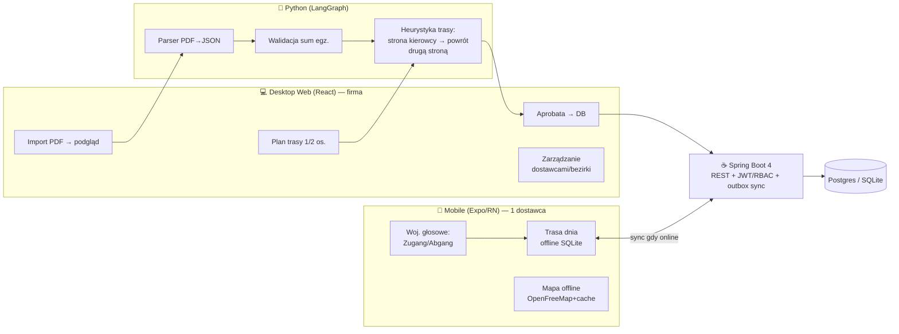

# Zeitungszusteller Platform — Plan działania (v2)

Wizja: platforma dla firmy dystrybucji prasy. Desktop (PC) zarządza wieloma dostawcami,
mobile (telefon) obsługuje jednego dostawcę w terenie, Python+AI czyta dokumenty i planuje trasy.

## Zasady projektu
- `real-data/` NIGDY do git (.gitignore) — dane realne; do repo generujemy syntetyczne dane testowe
  (skrypt `tools/generate_testdata.py`: niemieckie nazwiska, ulice, kody gazet z realnej struktury)
- Docker od pierwszego commitu: docker-compose = postgres + backend + frontend + python-service
- CI/CD: Jenkins (Jenkinsfile) — build → testy → obrazy Docker → deploy

## Stack (decyzje 2026)
| Warstwa | Wybór | Uzasadnienie |
|---|---|---|
| Backend API | Java 21 + Spring Boot 4.x, JPA | RBAC (Spring Security + JWT), profile: `dev`=SQLite / `prod`=Postgres — ten sam schemat |
| Desktop FE | React 19 + Vite + TypeScript | Stan serwera: **TanStack Query** (cache/sync); stan UI: **Zustand**. Redux Toolkit żyje, ale w 2026 trend = query+signals/zustand; Redux tu niepotrzebny |
| Mobile FE | React Native via **Expo** (expo-router, EAS) | Expo to dziś standard RN (bare workflow umarł); offline: expo-sqlite + outbox |
| AI/Parser | Python 3.12 + LangGraph | Pipeline: PDF → ekstrakcja → walidacja → plan trasy → **human-in-the-loop** (aprobata) → DB |
| Mapa offline | MapLibre GL JS + **OpenFreeMap** (OSM, bez API key) | Kafelki cache'owane w IndexedDB przez service worker → działa offline na trasie |
| Voice (mobile) | On-device speech recognition (de-DE, Android) | "Müller, Hauptstr. 12, BILD, abgang" → NLU → zmiana do outboxa; działa bez internetu |
| Infra | Docker Compose + Jenkins | Zero konfiguracji lokalnej; pipeline jako ćwiczenie portfolio |

## Model danych (JPA)
- `Zusteller` (id, imię, nazwisko, rola: ADMIN/ZUSTELLER)
- `Bezirk` (kod np. 8019, miejscowość, adres ablage, suma egz.)
- `Street` (bezirk_id, nazwa, kolejność w trasie)
- `DeliveryPoint` (street_id, nr domu, strona g/u + lewa/prawa, nazwisko klienta, kod gazety, egz., status AKTYWNY/ABGANG, version, updated_at)
- `NewspaperType` (kod: ME-OBB, FR-BILD, FR-SZ, ...)
- `SyncOutbox` / `ChangeLog` — kolejka zmian phone→desktop (wzorzec outbox + wersjonowanie = rozstrzyganie konfliktów)

## Role security (RBAC)
- ADMIN: wszystkie bezirki, import PDF, zarządzanie dostawcami
- ZUSTELLER: tylko własny bezirk, podgląd trasy dnia, zgłoszenia zmian

## Architektura

## Fazy (kolejność = wartość + portfolio)
### Faza 0 — Szkielet repo + Docker + CI
- Struktura: `backend/` (Maven), `frontend/` (Vite+React), `mobile/` (Expo), `ai-service/` (Python), `tools/`, `docker-compose.yml`, `Jenkinsfile`
- .gitignore z real-data/, generator danych testowych, README z instrukcją startu (1 komenda: docker compose up)
- ✅ Akceptacja: `docker compose up` podnosi postgres+backend (healthcheck)+frontend; Jenkinsfile przechodzi pipeline na lokalnym Jenkins

### Faza 1 — AI parser + API importu
- LangGraph pipeline: PDF → JSON (regex+LLM fallback) → walidacja (suma egz. == nagłówek) → human approval node
- Spring Boot: encje, repozytoria, REST CRUD, JWT login, role ADMIN/ZUSTELLER, profile sqlite/postgres
- ✅ Akceptacja: import realnego PDF-u przez UI z podglądem i aprobatą; testy jednostkowe + integracyjne (Testcontainers)

### Faza 2 — Desktop app (React)
- TanStack Query + Zustand; widoki: lista bezirków, trasa dnia, zarządzanie dostawcami, log zmian
- ✅ Akceptacja: pełny workflow ADMIN od PDF do DB w przeglądarce

### Faza 3 — Planowanie trasy
- Heurystyka Python: 1 osoba = przejazd stroną kierowcy → powrót drugą stroną (wyjątek: ≤N domów = jeden przejazd); 2 osoby = podział tras
- ✅ Akceptacja: endpoint zwraca uporządkowaną listę przystanków per przejazd; testy na danych testowych

### Faza 4 — Mobile app (Expo)
- Trasa dnia offline (expo-sqlite), widok "bieżący klient" podczas jazdy (nazwisko, nr domu, lewa/prawa, gazeta)
- Voice: on-device de-DE → NLU → zmiana do outboxa; sync z API gdy online (outbox + versioning)
- ✅ Akceptacja: tryb samolotowy — pełna trasa działa; po powrocie online zmiany synchronizują się bez konfliktów

### Faza 5 — Mapa offline + polerowanie
- MapLibre + OpenFreeMap, cache kafelek w IndexedDB (Workbox), podświetlenie bieżącej ulicy/stopu
- ✅ Akceptacja: mapa trasy działa offline; Jenkins deployuje całość na serwer

## Portfolio story (do CV)
Offline-first platforma logistyczna: Java+Python microservices, RBAC/JWT, AI pipeline z human-in-the-loop
(LangGraph), React+RN sync wzorcem outbox, offline maps, CI/CD Docker+Jenkins. Domena = realny problem.
