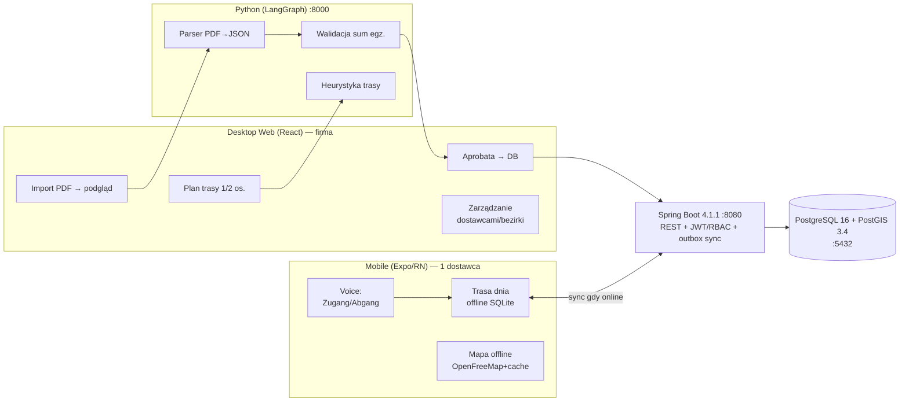

# Architektura — Zeitungszusteller Platform
Last Updated: 2026-10-21

## Przegląd systemów
Platforma składa się z 5 serwisów orkiestrowanych przez Docker Compose (sieć `app-network`):

| Serwis | Obraz / build | Port hosta | Rola |
| :--- | :--- | :--- | :--- |
| `global-postgis` | `postgis/postgis:16-3.4` | 5432 | Baza danych (PostgreSQL 16 + PostGIS 3.4) — wspólna dla GIS i backendu |
| `spring-backend` | build `./backend-spring` (Spring Boot 4.1.1, Java 21) | 8080 | API REST: CRUD, RBAC/JWT (Faza 1+), outbox sync |
| `python-langgraph` | build `./ai-pipeline` (Python 3.12, FastAPI) | 8000 | AI pipeline: parser PDF → JSON, walidacja, heurystyka trasy |
| `react-vite-frontend` | build `./frontend-web` (React 19 + Vite 6 + TS) | 5173 | Desktop web app (tryb dev z hot reload; produkcyjnie: statyczny build) |
| `jenkins-ci` | `jenkins/jenkins:lts-jdk17` (profil `ci`) | 8082 (+50000 agent) | CI/CD pipeline (`Jenkinsfile`) |
| `openfreemap-server` | `maptiler/tileserver-gl:v4.11.0` (profil `maps`, opcjonalne) | 8085 | Lokalny serwer kafelków OSM dla map offline |

## Diagram architektury

## Kluczowe przepływy danych
### Import dokumentu (Faza 1)
`PDF → POST /api/parse (ai-pipeline) → JSON + walidacja sum egz. → podgląd w UI → aprobata ADMIN → POST /api/bezirks (backend) → PostGIS`

### Sync mobile ↔ desktop (Faza 4)
Zmiany z terenu trafiają do lokalnej kolejki **outbox** (expo-sqlite). Gdy telefon ma zasięg:
`outbox → PUT /api/sync (backend, wersjonowanie) → rozstrzygnięcie konfliktów po version/updated_at → potwierdzenie → puste outbox`.

## Warstwa frontendowa
- **Desktop web** (`frontend-web/`): React 19 + TypeScript, Vite 6. Stan serwera: TanStack Query (Faza 2), stan UI: Zustand. Komunikacja z backendem przez `VITE_API_URL` (domyślnie `http://localhost:8080`).
- **Mobile** (`mobile-app/`, Faza 4): Expo + expo-router, expo-sqlite dla offline, voice on-device de-DE.
- Warstwa kliencka jest wygodą UX — autorytatywnym punktem egzekwowania uprawnień jest backend (RBAC), patrz `security_model.md`.

## Decyzje infrastrukturalne
- Docker Compose jako jedyne źródło konfiguracji środowiska lokalnego (NFR3); zmienne środowiskowe w compose, nie w kodzie.
- Profile: `ci` (Jenkins) i `maps` (serwer kafelków) — domyślnie podnoszone są 4 serwisy rdzeniowe.
- Healthchecki w compose (`depends_on: condition: service_healthy`) gwarantują kolejność startu.
