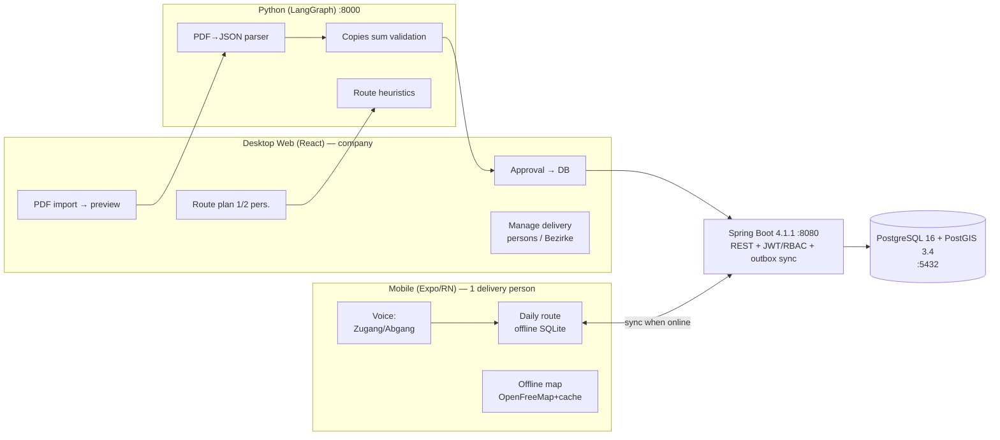

# Architecture — Zeitungszusteller Platform
Last Updated: 2026-10-21

## System Overview
The platform consists of five services orchestrated by Docker Compose (network `app-network`):

| Service | Image / build | Host port | Role |
| :--- | :--- | :--- | :--- |
| `global-postgis` | `postgis/postgis:16-3.4` | 5432 | Database (PostgreSQL 16 + PostGIS 3.4) — shared by GIS and backend |
| `spring-backend` | build `./backend-spring` (Spring Boot 4.1.1, Java 21) | 8080 | REST API: CRUD, RBAC/JWT (Phase 1+), outbox sync |
| `python-langgraph` | build `./ai-pipeline` (Python 3.12, FastAPI) | 8000 | AI pipeline: PDF → JSON parser, validation, route heuristics |
| `react-vite-frontend` | build `./frontend-web` (React 19 + Vite 6 + TS) | 5173 | Desktop web app (dev mode with hot reload; production: static build) |
| `jenkins-ci` | `jenkins/jenkins:lts-jdk17` (profile `ci`) | 8082 (+50000 agent) | CI/CD pipeline (`Jenkinsfile`) |
| `openfreemap-server` | `maptiler/tileserver-gl:v4.11.0` (profile `maps`, optional) | 8085 | Local OSM tile server for offline maps |

## Architecture Diagram

## Key Data Flows
### Document import (Phase 1)
`PDF → POST /api/parse (ai-pipeline) → JSON + copies-sum validation → UI preview → ADMIN approval → POST /api/bezirks (backend) → PostGIS`

### Mobile ↔ desktop sync (Phase 4)
Field changes land in a local **outbox** queue (expo-sqlite). When the phone is back online:
`outbox → PUT /api/sync (backend, versioning) → conflict resolution by version/updated_at → acknowledgement → outbox drained`.

## Frontend Layer
- **Desktop web** (`frontend-web/`): React 19 + TypeScript, Vite 6. Server state: TanStack Query (Phase 2); UI state: Zustand. Talks to the backend via `VITE_API_URL` (default `http://localhost:8080`).
- **Mobile** (`mobile-app/`, Phase 4): Expo + expo-router, expo-sqlite for offline, on-device de-DE voice input.
- The client layer is UX convenience — the authoritative enforcement point for permissions is the backend (RBAC), see `security_model.md`.

## Infrastructure Decisions
- Docker Compose is the single source of truth for the local environment (NFR3); configuration via environment variables in compose, not in code.
- Profiles: `ci` (Jenkins) and `maps` (tile server) — by default only the four core services start.
- Health checks in compose (`depends_on: condition: service_healthy`) guarantee startup ordering.
