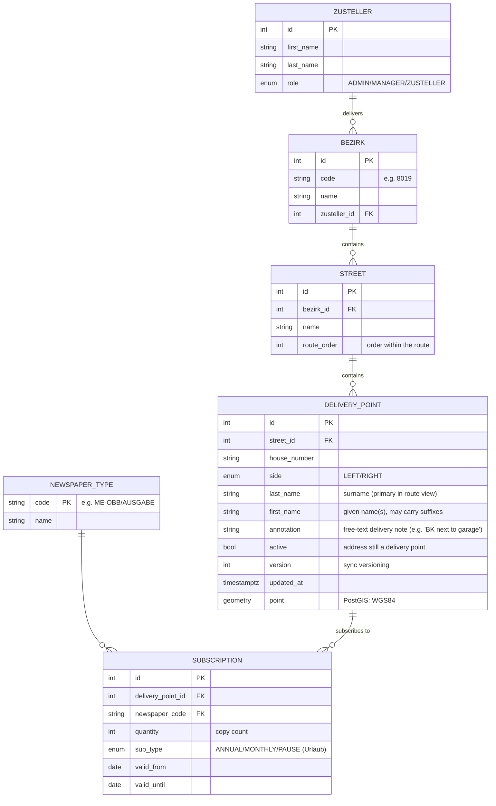

# Database Model — Zeitungszusteller Platform
Last Updated: 2026-10-21

## Current State (Phase 0)
Schema is empty. The backend is connected to the database (`ddl-auto: update`); JPA entities do not exist yet and will be created in Phase 1 together with migrations. The **PostGIS 3.4.3** extension is installed and verified (`db/init/01-postgis.sql`, mounted into `/docker-entrypoint-initdb.d`).

## Target Model (Phase 1+)
The structure mirrors the real Tagesliste document: street → house number → surname → newspaper code → copy count.

## Principles
- **Time-bounded subscriptions**: the daily list is *derived*, not stored — `WHERE today BETWEEN valid_from AND valid_until`. Zugang = new row with `valid_from` = today; Abgang = `valid_until` = yesterday; Urlaub (vacation pause) = a gap in validity, after which the subscription resumes automatically.
- **Versioning**: `DeliveryPoint.version` + `updated_at` — the basis for sync conflict resolution (F5).
- **Geometry**: each delivery point stored as `geometry(Point, 4326)` — GIST index for spatial queries (map, route planning).
- **Change tracking**: outbox / change log table (`sync_outbox`) — phone→desktop events with acknowledgement.
- Migrations: Flyway from Phase 1 (open decision in the roadmap — see `05_roadmap/roadmap.md`).
