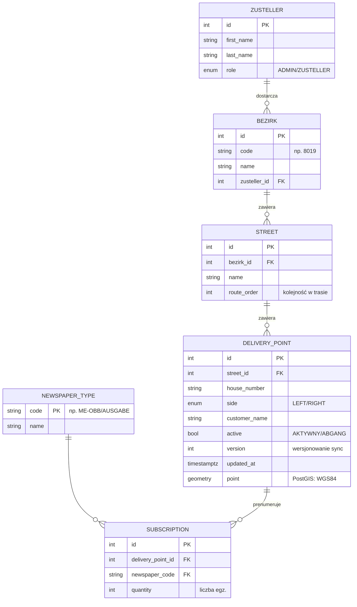

# Model bazy danych — Zeitungszusteller Platform
Last Updated: 2026-10-21

## Stan obecny (Faza 0)
Schemat pusty. Backend połączony z bazą (`ddl-auto: update`), encje JPA nie istnieją jeszcze —
tworzone w Fazie 1 wraz z migracjami. Rozszerzenie **PostGIS 3.4.3** zainstalowane i zweryfikowane
(`db/init/01-postgis.sql`, mount do `/docker-entrypoint-initdb.d`).

## Model docelowy (Faza 1+)
Struktura odwzorowuje realny dokument Tagesliste: ulica → nr domu → nazwisko → kod gazety → liczba egz.

## Zasady
- **Wersjonowanie**: `DeliveryPoint.version` + `updated_at` — podstawa rozstrzygania konfliktów sync (F5).
- **Geometria**: punkt dostawy jako `geometry(Point, 4326)` — indeks GIST dla zapytań przestrzennych (mapa, planowanie trasy).
- **Zmiany**: kolejka outbox / change log (tabela `sync_outbox`) — zdarzenia phone→desktop z potwierdzeniem odbioru.
- Migracje: Flyway od Fazy 1 (decyzja otwarta w roadmapie — patrz `05_roadmap/roadmap.md`).
